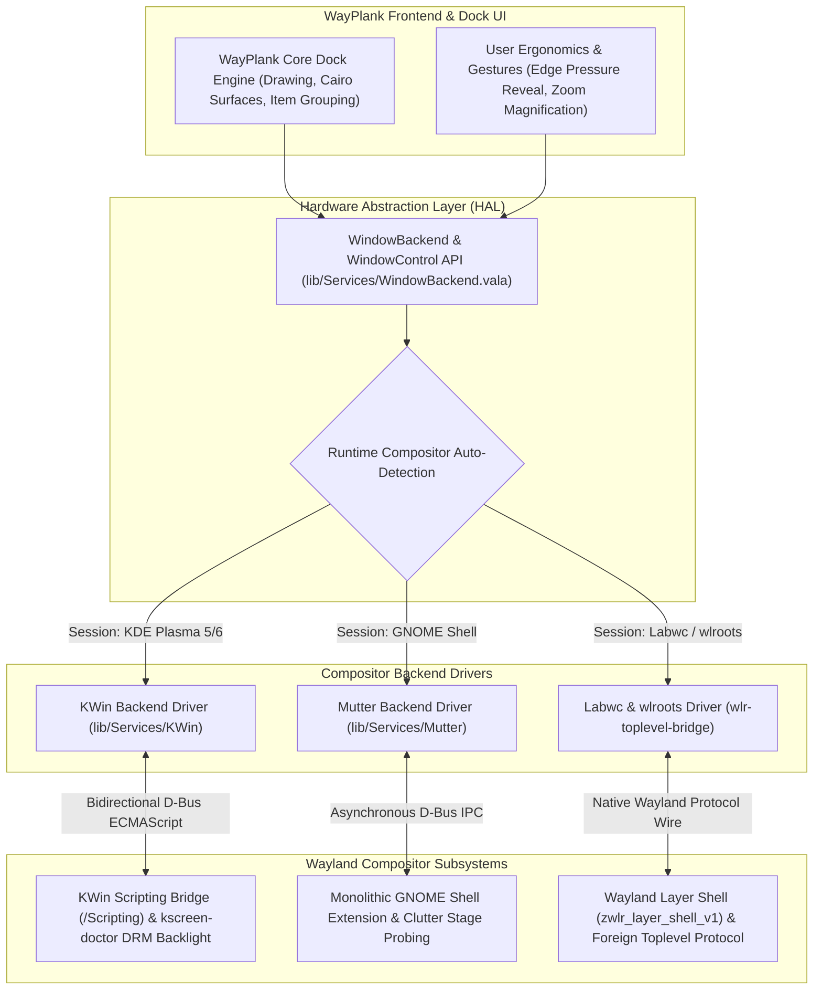

# WayPlank User Guide & Reference Manual

Welcome to **WayPlank**, the fast, lightweight, and modern dock designed natively for modern Wayland desktop environments (**KDE Plasma**, **GNOME**, **Labwc**, and beyond).

This manual provides an in-depth reference for all features, configuration options, gestures, and advanced setups—such as folder-based application menus, docklets, accordion collapsing, multi-monitor layouts, and our modular Hardware Abstraction Layer (HAL).

---

## Table of Contents
1. [Introduction](#1-introduction)
2. [Quick Start & Interface Layout](#2-quick-start--interface-layout)
3. [Folder Launchers (App Drawer Menus)](#3-folder-launchers-app-drawer-menus)
   - [How Folder Launchers Work](#how-folder-launchers-work)
   - [Default First-Run Folders](#default-first-run-folders)
   - [Creating Custom Folders](#creating-custom-folders)
   - [Adding and Managing Applications](#adding-and-managing-applications)
   - [Customizing Icons (Launchers, Folders & Docklets)](#customizing-icons-launchers-folders--docklets)
4. [Built-in Docklets & Accordion Mode](#4-built-in-docklets--accordion-mode)
   - [Complete List of 15 Docklets](#complete-list-of-15-docklets)
   - [Accordion Mode (Space-Saving Collapsible Docklets)](#accordion-mode-space-saving-collapsible-docklets)
   - [Configuring the Weather Docklet](#configuring-the-weather-docklet)
5. [Categorization & Dynamic Separators](#5-categorization--dynamic-separators)
   - [Categorized Layout Order](#categorized-layout-order)
   - [Permanent Trash Anchoring](#permanent-trash-anchoring)
   - [Dynamic Separators](#dynamic-separators)
   - [Dock Overflow Smooth Scrolling & Capacity Indicator](#dock-overflow-smooth-scrolling--capacity-indicator)
   - [Launcher Deduplication & Item Reuse](#launcher-deduplication--item-reuse)
6. [Mouse Gestures & Shortcuts](#6-mouse-gestures--shortcuts)
   - [Click Actions](#click-actions)
   - [Scroll Gestures](#scroll-gestures)
   - [Drag & Drop Interactions](#drag--drop-interactions)
   - [Quick Settings Access & In-App Help](#quick-settings-access--in-app-help)
7. [Multi-Monitor Setup & Screen Ergonomics](#7-multi-monitor-setup--screen-ergonomics)
   - [Monitor Selection & Alignment](#monitor-selection--alignment)
   - [Intelligent Hide & Edge Pressure](#intelligent-hide--edge-pressure)
   - [Multi-Monitor Topology & DPMS Wake Stability](#multi-monitor-topology--dpms-wake-stability)
   - [Multi-Monitor Hardware Brightness Control (SP/PV Decoupling)](#multi-monitor-hardware-brightness-control-sppv-decoupling)
8. [Hardware Abstraction Layer (HAL) & Compositor Architecture](#8-hardware-abstraction-layer-hal--compositor-architecture)
   - [The Wayland Security Model & Why WayPlank Needs an HAL](#the-wayland-security-model--why-wayplank-needs-an-hal)
   - [KDE Plasma: KWin D-Bus Scripting Bridge](#kde-plasma-kwin-d-bus-scripting-bridge)
   - [GNOME Shell: Monolithic Mutter Extension](#gnome-shell-monolithic-mutter-extension)
   - [Labwc & wlroots: Native Protocol Architecture](#labwc--wlroots-native-protocol-architecture)
   - [Runtime Auto-Detection Engine](#runtime-auto-detection-engine)
9. [Themes & Visual Customization](#9-themes--visual-customization)
   - [Built-in Themes](#built-in-themes)
   - [Installing Custom Themes](#installing-custom-themes)
   - [Dock Size & Zoom Level](#dock-size--zoom-level)
10. [Command Line Usage, Packaging & Configuration Files](#10-command-line-usage-packaging--configuration-files)
   - [CLI Commands](#cli-commands)
   - [Automated Packaging (Debian/Ubuntu & openSUSE/Fedora/RHEL)](#automated-packaging-debianubuntu--opensusefedorarhel)
   - [Configuration File Paths](#configuration-file-paths)
   - [GSettings Database Keys](#gsettings-database-keys)
11. [Troubleshooting & FAQ](#11-troubleshooting--faq)

---

## 1. Introduction

WayPlank is a native port and evolution of the classic Plank dock, rebuilt to thrive in modern Wayland display servers without X11 or XWayland workarounds.

### Key Highlights
- **Modular Multi-Compositor HAL:** Zero-configuration runtime detection and high-performance native window tracking across **KDE Plasma (KWin D-Bus Scripting Bridge)**, **GNOME (Monolithic Mutter Extension)**, and **Labwc/wlroots (`zwlr_foreign_toplevel`)** with zero X11 or XWayland dependencies.
- **Hardware-Level Brightness Control:** Atomic multi-monitor synchronization via KWin DRM `kscreen-doctor` calls, overcoming user-space PowerDevil I2C permission barriers on external HDMI/DisplayPort screens.
- **Categorized Dock Layout:** Automatic visual grouping of Folders, Docklets, Pinned Launchers, Running Windows, and the Trash can.
- **Folder Launchers:** Turn any directory into a Cairo-Dock style popup application menu with 60 FPS dynamic zoom elevation.
- **Accordion Docklets:** Keep system widgets accessible without cluttering your desktop space.
- **Fluid Animations:** Smooth zoom, bounce on launch, window attention indicators, and smoke poof animations when unpinning.
- **Sub-Second Instant Boot:** 0.74s instantaneous launch with asynchronous compositor handshake.

---

## 2. Quick Start & Interface Layout

When WayPlank starts with default settings, the dock is arranged into clean, logical visual sections separated by dynamic dividers:

```
[ Folders ]   |   [ Docklets ]   |   [ Pinned Apps ]   |   [ Open Apps ]   |   [ Trash ]
 📁 Internet        🎛️ Accordion       🌐 Web Browser       📝 Kate             🗑️ Trash
 💼 Office          (Preferences,      📁 File Manager      ...
 🎬 Media            Desktop,          💻 Terminal
 🎮 Games            Volume...)        ⚙️ Editor
```

- **Folders (Left):** Categorized application menus for fast access to your software library.
- **Docklets (Center-Left):** Interactive system widgets collapsed into an expandable accordion.
- **Pinned Applications (Center):** Direct single-click access to your essential daily tools.
- **Running Applications (Center-Right):** Temporary icons for active, unpinned windows.
- **Trash (Right):** Anchored permanently at the end of the dock for quick file disposal and ejection.

---

## 3. Folder Launchers (App Drawer Menus)

Folder Launchers provide a clean way to organize dozens of applications into compact menus directly on your dock.

### How Folder Launchers Work
When a dock item points to a directory (e.g., `Launcher=file:///path/to/directory`), WayPlank treats it as an application drawer. Clicking on it opens a menu displaying all `.desktop` applications found inside that folder, complete with their native icons and localized names.

### Default First-Run Folders
When WayPlank starts for the first time without an existing configuration, it automatically creates and populates four core folders under `~/.config/wayplank/folders/`:

1. **`Internet`**: Web browsers (Chrome, Firefox, Brave), email clients, messengers (Telegram, Discord), and network tools.
2. **`Office`**: Productivity suites (LibreOffice), text editors, calculators, document viewers, and IDEs.
3. **`Media`**: Media players (VLC, Totem), graphics software (GIMP, Inkscape), audio streamers (Spotify), and video recorders.
4. **`Games`**: Game launchers (Steam, Lutris, Heroic), emulators, and games (falls back to `Utilities` if no games are detected on the system).

### Creating Custom Folders
You can create as many custom folder drawers as you like:

1. Open your terminal or file manager and create a directory:
   ```bash
   mkdir -p ~/.config/wayplank/folders/"My Tools"
   ```
2. Simply **drag and drop** that folder from your file manager directly onto WayPlank.
3. WayPlank will instantly create a corresponding `.dockitem` and anchor the folder drawer to the dock.

### Adding and Managing Applications
To add applications to your folder drawer:
- **Via File Manager:** Navigate to `/usr/share/applications/` or `~/.local/share/applications/`, copy the `.desktop` files you want, and paste them (or symlink them) into your folder directory (`~/.config/wayplank/folders/<FolderName>/`).
- **Via Drag & Drop:** Drag an application `.desktop` file into the folder directory.

### Customizing Icons (Launchers, Folders & Docklets)
WayPlank provides an integrated, one-click icon personalization system directly from the dock:
1. **Right-click** on any application launcher, folder drawer, or docklet (`Preferences`, `Show Desktop`, `Session`, `Screenshot`, `Ejector`).
2. Select **Change Icon...** from the context menu.
3. The interactive **Icon Chooser** dialog will open:
   - **Live Theme Search:** Instant filtering across all 20,000+ icons in your active desktop theme.
   - **Browse File:** Select any custom image file (PNG, SVG, ICO, JPG) from your disk.
   - **Restore Default:** Reverts the item to its factory appearance.
4. Click **Apply** to update the icon immediately with zero restart needed.

> 💡 **Technical Note:** For application launchers, customizations follow the FreeDesktop standard (`~/.local/share/applications/`) without breaking Plank migration. For folders, icons are persisted using native GIO metadata (`metadata::custom-icon`), automatically recognized in Nautilus and Dolphin. For docklets, overrides are preserved in the `.dockitem` configuration.
>
> 🔄 **Theme Switching Resiliency:** When switching desktop icon themes, if an icon customized for a folder drawer does not exist in the new theme, WayPlank automatically restores the item to its default folder presentation (with 4-item card preview and folder styling), preventing missing/blank icon cards. Empty folder drawers also display a centered folder glyph so they are never rendered blank.

---

## 4. Built-in Docklets & Accordion Mode

WayPlank includes 15 built-in docklets that provide live system controls and status indicators.

### Complete List of 15 Docklets

| Docklet URI | Description |
| :--- | :--- |
| `docklet://trash` | Trash can indicator with fill status, empty action, and drag-to-delete. |
| `docklet://desktop` | Show/Hide Desktop toggle (minimizes or unminimizes all windows). |
| `docklet://preferences` | One-click access to WayPlank Preferences dialog. |
| `docklet://network` | Live network connectivity monitor (Wi-Fi / Ethernet), signal strength, IP address inspection, and quick launch to network settings. |
| `docklet://volume` | Audio volume level with scroll-to-adjust and mute toggle. |
| `docklet://brightness` | Screen brightness control with scroll-to-adjust. |
| `docklet://battery` | Battery charge percentage and charging status for laptops. |
| `docklet://cpu` | Real-time CPU usage monitor meter. |
| `docklet://weather` | Real-time weather conditions and temperature. |
| `docklet://clock` | Classic analog clock showing system time. |
| `docklet://digital-clock` | Digital 12h/24h time display. |
| `docklet://mpris` | Media player controller (Play/Pause, Next, Previous track). |
| `docklet://screenshot` | Instant desktop screen capture utility. |
| `docklet://session` | Session controls (Lock screen, Log out, Suspend, Restart, Shut down). |
| `docklet://ejector` | Safe removal and unmounting of removable USB drives and volumes. |

### Accordion Mode (Space-Saving Collapsible Docklets)
When **Accordion Mode** is enabled (`accordion-docklets = true`), multiple docklets are collapsed into a single compact master slot on the dock.
- **Hover Expansion**: In standard mode, hovering over or dragging across the docklet section smoothly expands all active docklets. Moving the pointer away collapses them back into a single icon after the configured delay.
- **Click to Expand Mode**: In Preferences -> Appearance, enable **Click to Expand**. In this mode, hovering does not expand the docklets; instead, a single click on the master Preferences anchor toggles expansion, and a second click opens the Preferences dialog.
- **Configurable Collapse Delay**: Adjust the collapse countdown timer (0.5s to 20.0s) using the slider in Preferences -> Appearance.
- **Directional Indicators**: The Preferences anchor tooltip dynamically shows directional arrows (`▸` / `◂`) indicating whether the accordion is collapsed or expanded.
- **Intelligent Retention**: If the dock autohides or dodges while the accordion is expanded, returning within the delay window preserves the expanded state.
- **Modal Interaction Invalidation**: The accordion collapse timer is automatically paused while any dialog (Preferences, Shortcuts & Gestures, Icon Chooser, Weather) or popup menu is active.

To toggle Accordion Mode:
- Open **Preferences** (`Ctrl + Right-Click` on the dock $\rightarrow$ *Preferences*).
- Under the **Appearance / Items** tab, toggle **Accordion Docklets**.

### Configuring the Weather Docklet
The weather docklet fetches local meteorological data:
1. Edit or inspect `~/.config/wayplank/dock1/launchers/weather.dockitem`:
   ```ini
   [PlankDockItemPreferences]
   Launcher=docklet://weather

   [PlankWeatherDockItemPreferences]
   # Leave empty for automatic IP-based location, or enter your city name:
   City=Rome
   # Temperature unit: C (Celsius) or F (Fahrenheit)
   Units=C
   ```
2. Changes take effect immediately upon saving the file.

---

## 5. Categorization & Dynamic Separators

WayPlank features a smart sorting engine that eliminates dock clutter.

### Categorized Layout Order
When **Categorize Items** is enabled (`categorize-items = true`), WayPlank automatically arranges all items in a strictly defined sequence:

$$\text{Folders} \longrightarrow \text{Docklets} \longrightarrow \text{Pinned Apps} \longrightarrow \text{Running Apps} \longrightarrow \text{Trash}$$

- You can freely reorder items *within* their category group.
- Items are never mixed across categories accidentally.

### Permanent Trash Anchoring
The Trash docklet (`docklet://trash`) is permanently anchored to the far end of the dock (the right side on horizontal docks, or the bottom on vertical docks). Even if you drag or open new applications, Trash stays fixed at the edge, exactly where muscle memory expects it.

### Dynamic Separators
WayPlank automatically inserts subtle vertical separator lines between adjacent, non-empty category groups:
- If you have Folders, Docklets, and Apps active, two separators are placed: `[Folders] | [Docklets] | [Apps]`.
- When an unpinned application opens, a separator appears before it: `[Apps] | [Active App] | [Trash]`.
- When the application closes, the separator cleanly vanishes without animation stutter.

### Dock Overflow Smooth Scrolling & Capacity Indicator
When pinning a high number of applications or operating on smaller displays (such as 1366×768 or 1080p laptop panels), dock items may exceed the monitor's physical boundaries:
- **Boundary Clamping**: WayPlank automatically clamps its background rendering strictly to the monitor's visible dimensions (`int.min(monitor_geo.width, background_width)`), guaranteeing the dock never extends off-screen or clips awkwardly.
- **Smooth Mouse Wheel Panning**: With the `Scroll on Overflow` toggle enabled (**Preferences $\rightarrow$ Behaviour**), rotating your mouse wheel over the dock surface shifts items smoothly with interpolated motion (`scroll_offset += (target_scroll_offset - scroll_offset) * 0.35`). Scrolling specifically over the Volume docklet continues to adjust audio volume without triggering overflow dock pan.
- **Tachometer Redline Capacity Indicator**: In the Preferences dialog (**Appearance $\rightarrow$ Icon Size**), a real-time capacity meter visually monitors total dock width against available screen pixels. When item dimensions approach screen capacity, the slider transitions into the redline zone and surfaces an explanatory tooltip detailing total pixel utilization.

### Launcher Deduplication & Item Reuse
To maintain a clean and reliable configuration:
- **Automatic Deduplication on Load**: When initializing or reloading launchers from disk, WayPlank queries active URIs. If duplicate `.dockitem` files exist for the same application, redundant files are safely removed from disk and ignored.
- **Deterministic Item Reuse**: Dragging or pinning an application that already exists in the dock reuses its existing `.dockitem` configuration rather than spawning redundant incremented filenames (such as `app-1.dockitem` or `app-2.dockitem`).
- **Auxiliary Bridge Window Shielding**: Internal background windows—such as `xwaylandvideobridge` surfaces used by Discord, Slack, and OBS for Wayland screen-sharing—are automatically detected and filtered out, preventing phantom 1×1 ghost launcher icons from cluttering your running apps list.

---

## 6. Mouse Gestures & Shortcuts

WayPlank offers an extensive set of mouse gestures and keyboard shortcuts designed for maximum productivity:

### Click Actions
- **Left Click**: Launch an application, or bring its existing window(s) to the foreground.
- **Middle Click** (or **Ctrl + Left Click**): Force launch a **NEW** instance of the application.
- **Right Click**: Open the application's context menu (displaying Desktop Actions / Quicklists, and "Keep in Dock").
- **Shift + Left Click**: Cycle focus to the next open window of that specific application.

### Scroll Gestures
- **Mouse Scroll on App Icon**: Smoothly cycle through all open windows of that application.
- **Mouse Scroll on Dock Surface (Overflow Mode)**: When dock items exceed available display boundaries and overflow scrolling is active, smoothly pan the dock items left/right or up/down.
- **Mouse Scroll on Volume Docklet**: Directly raise or lower the master system volume.
- **Mouse Scroll on Screen Brightness Docklet**: Adjust backlight intensity up or down in discrete 5% steps.
- **Ctrl + Mouse Scroll Up**: Dynamically increase dock icon size in real time.
- **Ctrl + Mouse Scroll Down**: Dynamically decrease dock icon size in real time.

### Drag & Drop Interactions
- **Drag icon off the dock**: Unpin and remove a launcher with a classic cartoon smoke ("poof") animation.
- **Drag icon along the dock**: Reorder launchers within their category.
- **Drop file onto an application icon**: Directly opens the dropped file in the target application (supports 0-byte files, multi-file payloads, full FreeDesktop `%U`/`%F` parameters, icon bounce feedback, and automatic window activation). If an application does not support the dropped file type, the drop is cleanly rejected without polluting the dock.
- **Drop folder onto a folder or directory-aware application**: Drops into a folder drawer to copy files, or onto a code editor/file manager (like Kate, Dolphin, VSCode) to open the project folder.
- **Drop onto empty dock space**: Pins files or folders as new dock items, or adds new application launchers from `.desktop` files.

### Quick Settings Access & In-App Help
- **Right Click (Any Item or Background)**: Instant access to **Shortcuts & Gestures...**, **Preferences...**, and **Quit**.
- **Ctrl + Right Click (Anywhere)**: Opens the WayPlank Preferences dialog directly, even when clicking over an active launcher icon.
- **Shortcuts & Gestures Dialog**: Visual reference dialog (`HelpWindow`) with categorized tabs explaining dock operations, gestures, and keyboard combinations.
- **Terminal CLI Cheatsheet**: Run `wayplank --help` in the terminal for a full, colorized quick-reference guide.
- **Right Click on empty dock space**: Opens the dock context menu.
- **Ctrl + Alt + Shift + Right Click**: Opens Developer Inspection Tools (launcher URI inspector, reload theme, inspect configuration).

---

## 7. Multi-Monitor Setup & Screen Ergonomics

WayPlank is architected from the ground up for modern multi-monitor Wayland workstations, whether utilizing homogeneous 4K displays or heterogeneous multi-output setups with mixed fractional scaling.

### Monitor Selection & Alignment
- **Position**: Place the dock on the `Bottom`, `Top`, `Left`, or `Right` edge of your screen.
- **Alignment**: Align the dock to `Center`, `Start` (Left/Top), or `End` (Right/Bottom).
- **Monitor Pinning**: In the Preferences dialog (**Preferences $\rightarrow$ Appearance $\rightarrow$ Monitor**), select the exact physical output where WayPlank should appear (e.g., `eDP-1`, `DP-1`, `HDMI-A-1`). When set to primary or specific outputs, WayPlank binds its layer-shell surface exclusively to that display geometry.

### Intelligent Hide & Edge Pressure
- **Hide Modes**:
  - `None`: Dock stays permanently on screen and reserves desktop strut space.
  - `Intelligent`: Dock automatically slides out of view only when an active window overlaps its territory.
  - `Autohide`: Dock hides whenever the mouse leaves its boundary.
  - `Dodge Active Window`: Dock hides only when the focused window overlaps it.
- **Pressure Reveal**: Requires touching the physical screen edge (1px barrier) before the dock reveals itself, preventing accidental triggers when moving the mouse across monitor boundaries or working near the border. When disabled, the dock unhides smoothly 10px before reaching the edge for fluid everyday access.

### Multi-Monitor Topology & DPMS Wake Stability
In complex multi-monitor environments, dynamic display changes—such as hotplugging an external screen, changing physical layout topology, or waking from system suspend / DPMS sleep—frequently cause race conditions in Wayland clients:
- **50ms Debounced Topology Sync**: WayPlank intercepts Gdk/Wayland display configuration events through a non-blocking 50ms debouncer, preventing display flicker or multiple surface rebuilds while displays renegotiate modes.
- **Persistent Output Mapping**: Monitor connector identifiers are tracked across sleep and resume cycles, ensuring the dock never jumps unexpectedly between displays when external docks or monitors re-enumerate.
- **Heterogeneous DPI & Fractional Scaling**: Layer-shell geometry and Cairo surface buffers automatically adjust scaling factors when moved across displays with differing device pixel ratios (HiDPI / LoDPI).

### Multi-Monitor Hardware Brightness Control (SP/PV Decoupling)
WayPlank's integrated Screen Brightness docklet features per-monitor hardware backlight and DDC/CI level synchronization:
- **KWin DRM Integration**: On KDE Plasma, WayPlank synchronizes brightness levels through KWin's DRM `kscreen-doctor` bridge and kernel interfaces, allowing fluid backlight adjustments across all connected displays without requiring root permissions or external background daemons.
- **Dedicated Background Worker with Target Coalescing**: On GNOME/Mutter and Labwc/wlroots, slow synchronous DDC/CI hardware I2C bus calls (`ddcutil`, `brightnessctl`) can introduce latency. WayPlank serializes hardware communication across a dedicated background worker thread with rapid target coalescing, keeping the dock completely fluid at 60 FPS even during heavy multi-monitor I2C transactions.
- **Set Point (SP) vs Process Variable (PV) Decoupling**: In industrial process control, an operator's commanded Set Point must never be clobbered by delayed sensor feedback. WayPlank implements an authoritative SP architecture: once you dial a brightness value, background polling cannot overwrite your target.
- **8-Second Settling Window & ±3% Deadband**: External D-Bus property updates originating from self-echoes or intermediate hardware steps are filtered through an 8-second settling window and a ±3% deadband, preventing badge bounce, slider flicker, and hardware oscillation across external HDMI/DP monitors and internal laptop panels.

---

## 8. Hardware Abstraction Layer (HAL) & Compositor Architecture

Unlike legacy X11—where any unprivileged client could globally poll window hierarchies, coordinates, and input focus via the root window—the **Wayland security model** intentionally isolates applications from one another. By design, a pure Wayland client cannot query other applications' windows or control desktop focus without explicit compositor cooperation.

To deliver full dock functionality—including running application indicators, window activation, minimize/restore toggling, dynamic Dodge/Intellihide window overlap tracking, and multi-monitor coordination—WayPlank incorporates a modular, zero-configuration **Hardware Abstraction Layer (HAL)** (`lib/Services/WindowBackend.vala` and `lib/Services/WindowControl.vala`).

### The Wayland Security Model & Why WayPlank Needs an HAL
In Wayland, the compositor acts as the display server, window manager, and compositor all in one. Standard Wayland protocols (`wl_compositor`, `wl_surface`) deliberately omit APIs for inspecting foreign toplevel windows to prevent keylogging and screen snooping.



### KDE Plasma: KWin D-Bus Scripting Bridge
On KDE Plasma (Plasma 5 & Plasma 6), WayPlank communicates with KWin via its native D-Bus scripting interface (`org.kde.KWin /Scripting`):
- **Dynamic ECMAScript Bridge**: WayPlank registers a high-performance helper script inside KWin's JavaScript runtime, providing bi-directional, event-driven notifications for window creation, destruction, focus shifts, minimization, and geometry changes.
- **Zero Polling Overhead**: Window geometry and state changes are delivered via D-Bus signal emissions, eliminating CPU-intensive polling loops.
- **Hardware-Level Display Sync**: Leverages `kscreen-doctor` for atomic multi-monitor brightness and output state synchronization.
- **Validated 100% FAT Stability**: Fully compliant with the WayPlank Factory Acceptance Test (FAT) matrix on KDE Plasma 6.

### GNOME Shell: Monolithic Mutter Extension
Because GNOME Shell (Mutter) does not implement the `zwlr_foreign_toplevel_manager_v1` protocol and restricts foreign window inspection, WayPlank features a self-deploying GNOME Shell extension:
- **Instantaneous 0.74s Startup**: Asynchronous initialization with zero synchronous evaluation freezes, achieving sub-second cold starts.
- **Clutter Stage Probing**: Multi-monitor boundaries and dock reveal triggers are probed directly through Clutter stage coordinates, guaranteeing responsive mouse unhide even on secondary screens located at bottom or lateral coordinates.
- **Window Geometry & Intellihide**: Provides real-time window boundary data over session D-Bus (`/org/gnome/Shell/Extensions/WayPlank`), powering intelligent dodge and hide calculations on GNOME Wayland sessions.
- **Non-Intrusive Desktop Integration**: Dialogs are centered automatically, and desktop notifications are delivered cleanly without intrusive banner overlays.

### Labwc & wlroots: Native Protocol Architecture
For modular Wayland environments such as Labwc, Wayfire, and generic wlroots-based compositors:
- **`gtk-layer-shell` Surface Management**: WayPlank anchors itself directly to the desktop using standard Wayland layer-shell protocol semantics (`zwlr_layer_shell_v1`), managing exclusive zones and autohide margins natively.
- **Foreign Toplevel Management**: Communicates via `zwlr_foreign_toplevel_manager_v1` using an optimized, native C bridge (`lib/Services/wlr-toplevel-bridge.c`), enabling window tracking, activation, minimization, and closing without intermediate desktop daemons.
- **State-Based Dodge & Honest UI**: Employs an intelligent window state filter (`DODGE_MAXIMIZED` and focused window tracking), validated across lightweight Wayland environments including LXQt 2.x and XFCE 4.20 on Labwc.

### Runtime Auto-Detection Engine
WayPlank requires zero user configuration or environment toggles to select the correct compositor backend:
- During startup, the HAL detection engine inspects session environment variables (`XDG_CURRENT_DESKTOP`, `XDG_SESSION_TYPE`, `WAYLAND_DISPLAY`), tests compositor D-Bus interfaces, and probes supported Wayland protocol globals.
- It dynamically binds the optimal driver at runtime with graceful fallback, ensuring a seamless, out-of-the-box user experience regardless of distribution or desktop environment.

---

## 9. Themes & Visual Customization

### Built-in Themes
WayPlank ships with five built-in static themes and an adaptive dynamic GTK theme engine:
1. **Arian Theme**: Modern dark translucent glass with subtle border illumination.
2. **Arian Theme Light**: Clean frosted glass designed for light desktop environments.
3. **Transparent**: Ultra-minimalist borderless design showing only floating icons.
4. **Matte**: Flat, modern solid finish.
5. **Default**: Classic Plank appearance.
6. **Gtk+**: Adaptive dynamic theme engine that samples the active system GTK palette (background, accent, borders) and automatically synchronizes with Dark and Light desktop modes in real time.

### Installing Custom Themes (100% Plank Compatibility)
WayPlank maintains 100% backward compatibility with Plank themes (`dock.theme` and `hover.theme`). You can install third-party Plank themes in any of the following standard directories:
```bash
~/.local/share/wayplank/themes/<ThemeName>/dock.theme
~/.local/share/plank/themes/<ThemeName>/dock.theme
~/.themes/<ThemeName>/dock.theme
/usr/share/wayplank/themes/<ThemeName>/dock.theme
/usr/share/plank/themes/<ThemeName>/dock.theme
```
They will instantly appear in the **Preferences $\rightarrow$ Theme** dropdown menu.

### Dock Size & Zoom Level
- **Icon Size**: Adjustable from 24px up to 128px.
- **Icon Zoom (Magnification)**: When enabled, icons smoothly magnify up to 200% under the mouse cursor, with physics-based smooth interpolation.

---

## 10. Command Line Usage, Packaging & Configuration Files

### CLI Commands
```bash
# Start WayPlank
wayplank

# Open the Preferences dialog directly
wayplank --preferences

# Run in debug mode with verbose logging
wayplank -d

# Show current version and build information
wayplank --version
```

### Automated Packaging (Debian/Ubuntu & openSUSE/Fedora/RHEL)
WayPlank provides native, standalone packaging scripts requiring zero manual Makefile manipulation:

- **Debian, Ubuntu & Derivatives (`.deb`)**:
  ```bash
  chmod +x BuildDeb.sh
  ./BuildDeb.sh
  sudo apt install ./build/wayplank_0.6.2.2_amd64.deb
  ```

- **openSUSE, Fedora & RHEL (`.rpm`)**:
  ```bash
  chmod +x BuildRpm.sh
  ./BuildRpm.sh
  # On openSUSE:
  sudo zypper install ./build/wayplank-0.6.2.2-1.x86_64.rpm
  # On Fedora / RHEL:
  sudo dnf install ./build/wayplank-0.6.2.2-1.x86_64.rpm
  ```

> 💡 **Headless / CI Automation**: All build scripts support non-interactive execution via `WAYPLANK_NO_PROMPT=1` (e.g., `WAYPLANK_NO_PROMPT=1 ./BuildDeb.sh`).

### Configuration File Paths
- **Launchers Directory**: `~/.config/wayplank/dock1/launchers/`
- **Folder Drawers**: `~/.config/wayplank/folders/`
- **Custom Themes**: `~/.local/share/plank/themes/`
- **Cache & Temporary Files**: `~/.cache/wayplank/`

### GSettings Database Keys
All settings are stored in the GSettings schema `net.launchpad.plank.dock.settings:/net/launchpad/plank/docks/dock1/`:
```bash
# Read all current dock settings
gsettings list-recursively net.launchpad.plank.dock.settings:/net/launchpad/plank/docks/dock1/

# Toggle categorized items
gsettings set net.launchpad.plank.dock.settings:/net/launchpad/plank/docks/dock1/ categorize-items true

# Toggle accordion docklets
gsettings set net.launchpad.plank.dock.settings:/net/launchpad/plank/docks/dock1/ accordion-docklets true

# Toggle dock overflow smooth scrolling
gsettings set net.launchpad.plank.dock.settings:/net/launchpad/plank/docks/dock1/ scroll-overflow true

# Change dock theme
gsettings set net.launchpad.plank.dock.settings:/net/launchpad/plank/docks/dock1/ theme 'Arian Theme Light'
```

---

## 11. Troubleshooting & FAQ

#### Q: How do I open Preferences if the preferences icon is missing?
**A:** Hold the **`Ctrl`** key and **Right-Click** anywhere on the dock, or run `wayplank --preferences` in a terminal.

#### Q: How do I add an application that is not in the default folders?
**A:** Open your Application Menu (KDE Kickoff, GNOME Dash, Labwc menu) or your file manager (Dolphin, Nautilus, Thunar) at `/usr/share/applications/`, and simply drag the `.desktop` file onto WayPlank.

#### Q: Can I reset WayPlank to its initial default state?
**A:** Yes. Close WayPlank, remove the configuration folder, and start WayPlank again:
```bash
killall wayplank
rm -rf ~/.config/wayplank/dock1/
wayplank &
```
WayPlank will automatically regenerate the clean modern defaults with folders, docklets, and pinned applications.

---

*WayPlank is free software licensed under the GNU General Public License v3.*  
*Copyright © 2011–2015 Plank Developers | Copyright © 2026 Sergio Melas & WayPlank Contributors.*

