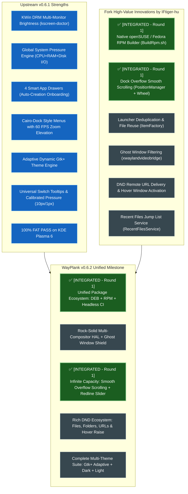

# 🗺️ WayPlank v0.6.2 Roadmap: Fork Integration & Community Unification

**Document Version:** 1.0  
**Date:** 2026-10-15  
**Maintainer:** Sergio Melas (sergiomelas@gmail.com, GitHub: [@sergiomelas](https://github.com/sergiomelas))  
**Collaborator & Author:** IFtiger-hu (史有虎) (2212363803@qq.com, GitHub: [@IFtiger-hu-hub](https://github.com/IFtiger-hu-hub))  
**Target Milestone:** WayPlank v0.6.2 — "The Community Unification & Distribution Release"  
**Upstream Repository:** [https://github.com/sergiomelas/WayPlank](https://github.com/sergiomelas/WayPlank)  
**Collaborator Fork:** [https://github.com/IFtiger-hu-hub/WayPlank](https://github.com/IFtiger-hu-hub/WayPlank)  

---

## 1. 🤝 Formal Accreditation & Collaboration Authorization

On 2026-10-15, fork author **IFtiger-hu (史有虎)** formally authorized the upstream project maintainer **Sergio Melas** to cherry-pick, adapt, and integrate features, improvements, and bug fixes from the fork (`https://github.com/IFtiger-hu-hub/WayPlank`) directly into upstream `main` for release in **WayPlank v0.6.2**:

> *"You have my full permission and authorization to cherry-pick and adapt any features, improvements, or fixes from my fork (https://github.com/IFtiger-hu-hub/WayPlank) directly into upstream main.*  
> *This includes: Native openSUSE RPM automated packaging support (BuildRpm.sh), launcher deduplication and backend bridge window filtering fixes, dock overflow smooth scrolling and adaptive Light/Dark theme toggle, drag-and-drop file/URL delivery onto dock icons and hover window triggering."*  
> — **IFtiger-hu (史有虎)**, Fork Maintainer

### Formal Attribution Protocol:
1. **Git Commit History Preservation**:
   - Every ported commit from the fork will strictly preserve original author attribution:
     ```bash
     --author="史有虎-openSUSE-Tumbleweed <2212363803@qq.com>"
     ```
2. **README.md Acknowledgments**:
   - A dedicated `## 🤝 Acknowledgments & Contributors` section in `README.md` will prominently recognize IFtiger-hu (史有虎) and link to his GitHub profile and fork.
3. **Changelog & Documentation**:
   - `Changelogs/CHANGELOG_v0.6.2.md` will detail every ported feature with explicit credits and citations.

---

## 2. 🔍 Commit-by-Commit Fork Audit (`fork/main`)

The fork branched from upstream at tag `v0.5.2` (`5729885`) and produced 17 commits up to tag `v0.5.5` (`5693d80`). Here is the granular technical breakdown:

| Fork Commit | Tag / Area | Summary of Changes | Upstream v0.6.1 Status & Overlap | Recommended Action for v0.6.2 |
| :--- | :--- | :--- | :--- | :--- |
| **`ccb79c0`** | `Packaging` | Added native openSUSE / Fedora RPM builder (`BuildRpm.sh`) and spec file template. | 🟢 **Zero overlap**. Upstream only had `.deb` and binary script. Tested and verified working. | ✅ **COMPLETED (Round 1)**: Integrated `BuildRpm.sh` with non-interactive headless CI bypass. |
| **`e1d6a03`** | `v0.5.3` / `Layout` | **Dock Overflow Smooth Scrolling**: Clamps dock background to screen width/height, adds mouse wheel scroll offset, and smooth animated scrolling when items exceed screen bounds. | 🟢 **Zero overlap**. Upstream relied solely on item padding reduction/auto-shrink. | ✅ **COMPLETED (Round 1)**: Integrated overflow scrolling + Preferences Behaviour switch + Tachometer Redline slider. |
| **`9108354`** | `Theming` | Added `lib/Services/SystemTheme.vala` (listening to FreeDesktop portal color-scheme) and `Light/dock.theme`. | 🟡 **Partial overlap**. Upstream v0.6.1 created the dynamic adaptive "Gtk+" engine. | **Phase 2: Integrate Portal Listener**. Wire `SystemTheme.vala` into upstream adaptive theme engine. |
| **`b2b228c`** | `Icons` | System library custom icon chooser dialog (`IconChooserDialog.vala`). | 🔵 **Already Solved in Upstream v0.6.0**. Upstream implemented a full 20,000+ theme icon browser with GIO metadata persistence. | **Review & Compare**: Ensure upstream has all system path fallbacks. |
| **`a19c053`**<br>**`af0293a`**<br>**`b9f8ba7`**<br>**`10809c4`** | `v0.5.4` / `DND` | Drag-and-drop file/URL delivery (`launch_with_uris`), smart drop capsule tooltip, hover window popup activation. | 🟡 **Partial overlap**. Upstream v0.6.1 solved 0-byte MIME fallbacks, folder drops, and bounce feedback. | **Phase 2: Merge Enhancements**. Adopt `launch_with_uris` (remote URLs) & hover window raising. |
| **`81430b3`** | `Themes` | Restored classic Default theme; moved reverse rounded dark theme to standalone `Dark`. | 🟡 **Theme styling**. | **Phase 3: Theme Catalog**. Add `Dark` and `Light` as packaged stock themes. |
| **`5693d80`** | `v0.5.5` / `Core` | **Launcher Deduplication & Item Reuse** in `ItemFactory.vala`; filter `xwaylandvideobridge` in `ApplicationDiscovery.vala` and KWin bridge. | 🟢 **High Value Fix**. Prevents duplicated `.dockitem` generation and ghost bridge windows. | **Phase 1: Port Deduplication & Ghost Filter**. High stability impact. |
| **`81ea31a`** | `Visual` / `Cards` | Multi-window card expansion, reverse fillet skirt rendering, `RecentFilesService.vala`. | ⚠️ **Architectural Divergence**. Modifies `ApplicationDockItem` with custom card widgets and deep `lib/Services` hooks. | **Phase 3: Deep Evaluation**. Needs careful inspection to prevent breaking upstream menu/cairo architecture. |

---

## 3. 🎯 Detailed Gap Analysis: Upstream v0.6.1 vs Fork



---

## 4. 🚀 Step-by-Step Integration Phases for v0.6.2

### Phase 1: Zero-Risk Quick Wins (Packaging & Core Deduplication)
*Goal: Immediate high-value additions with zero risk to the runtime dock or HAL.*

1. **Native openSUSE / Fedora RPM Packaging (`BuildRpm.sh`)** — ✅ **COMPLETED (Round 1)**:
   - Port `BuildRpm.sh` from commit `ccb79c0`.
   - Update script to dynamic version extraction (`v0.6.2`).
   - Add automated detection of package managers (`zypper`, `dnf`, `apt` for `rpmbuild`).
   - Add `--define "_dbpath %{_topdir}/rpmdb"` to suppress Debian/Ubuntu sqlite database lookup warnings.
   - Add non-interactive headless bypass flags (`WAYPLANK_NO_PROMPT=1`, `CI=1`, `NONINTERACTIVE=1`).
   - Document RPM build steps in `README.md` alongside Debian/Arch instructions.
2. **Launcher Deduplication & Item Reuse (`lib/Factories/ItemFactory.vala`)**:
   - Port deduplication logic from commit `5693d80`.
   - In `get_dock_elements_from_dir`: if duplicate URI launcher exists, cleanly prune it.
   - In `create_dock_item`: reuse existing `.dockitem` file matching the URI instead of incrementing `-1.dockitem`, `-2.dockitem`.
3. **Ghost Window & Screen-Sharing Bridge Shielding (`lib/Services/ApplicationDiscovery.vala`)**:
   - Port `is_ignored_app()` to filter out `xwaylandvideobridge` (which generates transparent 1x1 ghost windows during Discord/WebRTC screen sharing on Wayland).

---

### Phase 2: User Experience & Ergonomic Enhancements
*Goal: Expand dock navigation and Drag-and-Drop capabilities.*

1. **Dock Overflow Smooth Scrolling (`lib/PositionManager.vala`, `lib/DockRenderer.vala`, `lib/Widgets/DockWindow.vala`)** — ✅ **COMPLETED (Round 1)**:
   - Port overflow bounding logic from `e1d6a03`:
     - Calculate `available_content_span` and `max_scroll_offset`.
     - When total icons exceed screen span, clamp background and enable horizontal/vertical scroll offset.
     - Intercept mouse wheel events on dock surface (with volume & brightness docklet bypass) to smoothly shift icons.
     - Smooth interpolation formula: `scroll_offset += (target_scroll_offset - scroll_offset) * 0.35`.
   - Added user setting **`Scroll on Overflow`** toggle switch in **Preferences $\rightarrow$ Behaviour** under Item Management (`scroll-overflow` GSettings key).
   - Added dynamic **Screen Space Capacity Indicator & Auto-Shrink Warning** to Appearance Icon Size slider (Tachometer Redline styling with exact pixel tick marks and explicative tooltips).
   - Preserved Accordion Docklets drawer architecture and prevented docklet scroll event hijacking.
2. **DND Remote URL Delivery & Hover Window Raising (`lib/Services/System.vala`, `lib/Items/ApplicationDockItem.vala`)**:
   - Port `launch_with_uris()` to handle `http://`, `https://` web URLs and dispatch to browser/app via `DesktopAppInfo.launch_uris()`.
   - Port hover window activation: when dragging a file/URL and hovering over a running app icon for >500ms, bring that app's window forward so the user can drop directly into the application workspace.
3. **FreeDesktop Color-Scheme Portal Synchronization (`lib/Services/SystemTheme.vala`)**:
   - Integrate D-Bus listener on `org.freedesktop.portal.Settings` (`color-scheme`).
   - Link portal events directly to our `Theme.vala` adaptive Gtk+ engine to trigger instantaneous re-rendering on dark/light switch without needing manual dock restart.

---

### Phase 3: Visual Polish & Extended Themes
*Goal: Enrich theme offerings and explore multi-window cards.*

1. **Stock Theme Suite (`data/themes/`)**:
   - Integrate `Dark` and `Light` stock themes from `81430b3` and `9108354`.
   - Preserve our adaptive `Gtk+` dynamic engine as the flagship default.
2. **Recent Files Jump List (`lib/Services/RecentFilesService.vala`)**:
   - Port `RecentFilesService` querying `Gtk.RecentManager`.
   - Add "Recent Documents" submenu to compatible application right-click menus.
3. **Multi-Window Window Cards Evaluation**:
   - Evaluate fork's `WindowCardDockItem` against upstream Cairo-Dock style folder menus.
   - Ensure complete compositor neutrality across KWin, Mutter, and Labwc before adopting.

---

## 5. 🛡️ Quality Assurance & FAT Protocol Impact

Every phase will be validated against our standard **Multi-Compositor FAT Matrix** (`FAT/`):

1. **Packaging Validation**:
   - Test `./BuildDeb.sh` on Debian Sid / Ubuntu 24.04.
   - Test `./BuildRpm.sh` on openSUSE Tumbleweed, openSUSE Leap, Fedora 41, and Debian Sid.
   - Verify generated packages install cleanly, register icons, compile schemas, and execute `wayplank --replace`.
2. **Deduplication FAT Point**:
   - Rapidly drag-and-drop the same application multiple times; verify zero duplicate `.dockitem` files are spawned in `~/.config/wayplank/dock1/launchers/`.
3. **Overflow Scrolling FAT Point**:
   - Pin 35+ applications on a 1080p display; verify dock clamps to screen edges, renders cleanly, and mouse wheel scrolls fluidly through the entire launcher sequence without glitching.
4. **Compositor Regression Shield**:
   - Re-run KDE Plasma Session 2 (already 100% PASS), GNOME Session 1, and Labwc Session 3 to guarantee zero regressions.

---

## 6. 🤝 Attribution & Documentation Plan

1. **Git Commit Authorship**:
   - Commits will be imported using `git cherry-pick` or `git commit --author="史有虎-openSUSE-Tumbleweed <2212363803@qq.com>"`.
2. **README.md Acknowledgments**:
   - Add a dedicated section:
     ```markdown
     ## 🤝 Acknowledgments & Contributors
     * **史有虎 (IFtiger-hu)** (@IFtiger-hu-hub): Co-author of native openSUSE/Fedora RPM packaging (`BuildRpm.sh`), dock overflow smooth scrolling architecture, and launcher deduplication engine.
     ```
3. **Changelog Documentation**:
   - All integrated features will be documented in `Changelogs/CHANGELOG_v0.6.2.md` with explicit credits and commit references.

---
*WayPlank Project Documentation • Maintained by Sergio Melas & Contributors*
