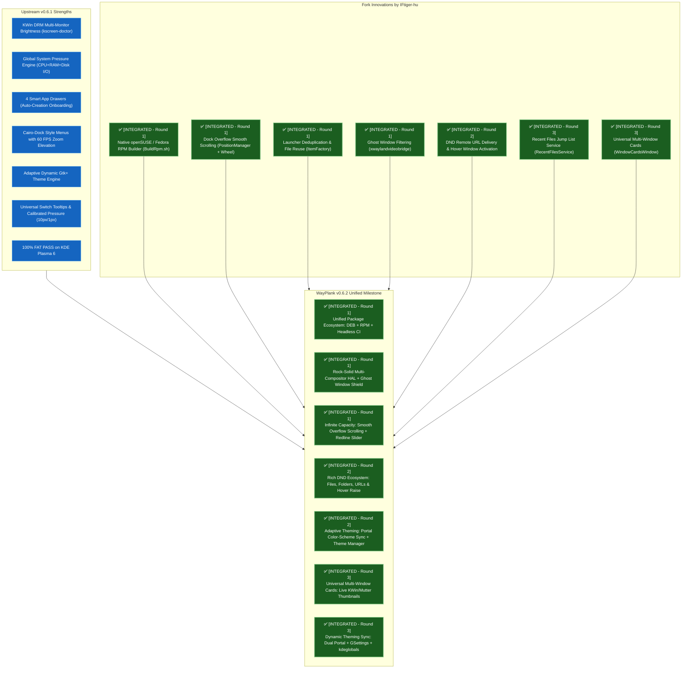

# 🗺️ WayPlank v0.6.2 Roadmap: Fork Integration & Community Unification

**Document Version:** 1.0  
**Date:** 2026-10-15  
**Maintainer:** Sergio Melas (sergiomelas@gmail.com, GitHub: [@sergiomelas](https://github.com/sergiomelas))  
**Collaborator & Author:** IFtiger-hu (史有虎) (2212363803@qq.com, GitHub: [@IFtiger-hu-hub](https://github.com/IFtiger-hu-hub))  
**Target Milestone:** WayPlank v0.6.2 — "The Community Unification & Distribution Release"  
**Upstream Repository:** [https://github.com/sergiomelas/WayPlank](https://github.com/sergiomelas/WayPlank)  
**Collaborator Fork:** [https://github.com/IFtiger-hu-hub/WayPlank](https://github.com/IFtiger-hu-hub/WayPlank)  

---

## 1. 🤝 Formal Accreditation & Collaboration Authorization

On 2026-10-15, fork author **IFtiger-hu (史有虎)** formally authorized the upstream project maintainer **Sergio Melas** to cherry-pick, adapt, and integrate features, improvements, and bug fixes from the fork (`https://github.com/IFtiger-hu-hub/WayPlank`) directly into upstream `main` for release in **WayPlank v0.6.2**:

> *"You have my full permission and authorization to cherry-pick and adapt any features, improvements, or fixes from my fork (https://github.com/IFtiger-hu-hub/WayPlank) directly into upstream main.*  
> *This includes: Native openSUSE RPM automated packaging support (BuildRpm.sh), launcher deduplication and backend bridge window filtering fixes, dock overflow smooth scrolling and adaptive Light/Dark theme toggle, drag-and-drop file/URL delivery onto dock icons and hover window triggering."*  
> — **IFtiger-hu (史有虎)**, Fork Maintainer

### Formal Attribution Protocol:
1. **Git Commit History Preservation**:
   - Every ported commit from the fork will strictly preserve original author attribution:
     ```bash
     --author="史有虎-openSUSE-Tumbleweed <2212363803@qq.com>"
     ```
2. **README.md Acknowledgments**:
   - A dedicated `## 🤝 Acknowledgments & Contributors` section in `README.md` will prominently recognize IFtiger-hu (史有虎) and link to his GitHub profile and fork.
3. **Changelog & Documentation**:
   - `Changelogs/CHANGELOG_v0.6.2.md` will detail every ported feature with explicit credits and citations.

---

## 2. 🔍 Commit-by-Commit Fork Audit (`fork/main`)

The fork branched from upstream at tag `v0.5.2` (`5729885`) and produced 17 commits up to tag `v0.5.5` (`5693d80`). Here is the granular technical breakdown:

| Fork Commit | Tag / Area | Summary of Changes | Upstream v0.6.1 Status & Overlap | Recommended Action for v0.6.2 |
| :--- | :--- | :--- | :--- | :--- |
| **`ccb79c0`** | `Packaging` | Added native openSUSE / Fedora RPM builder (`BuildRpm.sh`) and spec file template. | 🟢 **Zero overlap**. Upstream only had `.deb` and binary script. Tested and verified working. | ✅ **COMPLETED (Round 1)**: Integrated `BuildRpm.sh` with non-interactive headless CI bypass. |
| **`e1d6a03`** | `v0.5.3` / `Layout` | **Dock Overflow Smooth Scrolling**: Clamps dock background to screen width/height, adds mouse wheel scroll offset, and smooth animated scrolling when items exceed screen bounds. | 🟢 **Zero overlap**. Upstream relied solely on item padding reduction/auto-shrink. | ✅ **COMPLETED (Round 1)**: Integrated overflow scrolling + Preferences Behaviour switch + Tachometer Redline slider. |
| **`9108354`** | `Theming` | Added `lib/Services/SystemTheme.vala` (listening to FreeDesktop portal color-scheme) and `Light/dock.theme`. | 🟡 **Partial overlap**. Upstream v0.6.1 created the dynamic adaptive "Gtk+" engine. | ✅ **COMPLETED (Round 2 & 3)**: Wired `SystemTheme.vala` into dynamic theme engine with full dual-portal, GNOME GSettings, and KDE `kdeglobals` monitoring. |
| **`b2b228c`** | `Icons` | System library custom icon chooser dialog (`IconChooserDialog.vala`). | 🔵 **Already Solved in Upstream v0.6.0**. Upstream implemented a full 20,000+ theme icon browser with GIO metadata persistence. | **Review & Compare**: Ensure upstream has all system path fallbacks. |
| **`a19c053`**<br>**`af0293a`**<br>**`b9f8ba7`**<br>**`10809c4`** | `v0.5.4` / `DND` | Drag-and-drop file/URL delivery (`launch_with_uris`), smart drop capsule tooltip, hover window popup activation. | 🟡 **Partial overlap**. Upstream v0.6.1 solved 0-byte MIME fallbacks, folder drops, and bounce feedback. | ✅ **COMPLETED (Round 2)**: Integrated remote URLs, hover-to-raise window activation, and strict MIME validation. |
| **`81430b3`** | `Themes` | Restored classic Default theme; moved reverse rounded dark theme to standalone `Dark`. | 🟡 **Theme styling**. | ✅ **COMPLETED (Round 3)**: Added `Dark`, `Light`, `Arian Dark/Light`, and `IFtiger Dark/Light` as packaged stock themes. |
| **`5693d80`** | `v0.5.5` / `Core` | **Launcher Deduplication & Item Reuse** in `ItemFactory.vala`; filter `xwaylandvideobridge` in `ApplicationDiscovery.vala` and KWin bridge. | 🟢 **High Value Fix**. Prevents duplicated `.dockitem` generation and ghost bridge windows. | ✅ **COMPLETED (Round 1)**: Integrated launcher deduplication, item reuse, and ghost window shielding. |
| **`81ea31a`** | `Visual` / `Cards` | Multi-window card expansion, reverse fillet skirt rendering, `RecentFilesService.vala`. | ⚠️ **HAL Positioning & Geometry Challenge**. Inline expansion previously risked Mutter/Labwc HAL displacement. | ✅ **COMPLETED (Round 3)**: Solved via elevated floating Cairo popup (`WindowCardsWindow`), live thumbnails on KWin/Mutter, blank cards on Labwc, and `RecentFilesService`. |

---

## 3. 🎯 Detailed Gap Analysis: Upstream v0.6.1 vs Fork



---

## 4. 🚀 Step-by-Step Integration Phases & Version Alignment

To preserve linear versioning, eliminate ambiguity, and provide clean standalone packages for each integration milestone, every Round maps directly to a sequential sub-version (`v0.6.2.x`):

* **v0.6.2.1 (Round 1)**: Native RPM Packaging, Overflow Scrolling, Launcher Deduplication, Ghost Window Shield & Multi-Monitor DDC/CI Sync — ✅ **COMPLETED (Released 2026-10-17)**.
* **v0.6.2.2 (Round 2)**: DND Remote URLs, Hover Window Raising, FreeDesktop Portal Sync, Theme Manager & Strict MIME — ✅ **COMPLETED (Released 2026-10-21)**.
* **v0.6.2.3 (Round 3)**: Packaged Stock Themes, Recent Files Jump List, Dynamic Theme Swapping, Universal Multi-Window Cards, Folder Running Dots, Drawer UX Parity & Native Peer Stacking — ✅ **COMPLETED (100% FAT Passed, Released 2026-10-22)**.

---

### Phase 1 (Round 1): Zero-Risk Quick Wins & Core Foundation — 🏁 RELEASE MILESTONE: v0.6.2.1
*Goal: Immediate high-value additions with zero risk to the runtime dock or HAL.*

1. **Native openSUSE / Fedora RPM Packaging (`BuildRpm.sh`)** — ✅ **COMPLETED (v0.6.2.1)**:
   - Port `BuildRpm.sh` from commit `ccb79c0`.
   - Update script to dynamic version extraction (`v0.6.2.1`).
   - Add automated detection of package managers (`zypper`, `dnf`, `apt` for `rpmbuild`).
   - Add `--define "_dbpath %{_topdir}/rpmdb"` to suppress Debian/Ubuntu sqlite database lookup warnings.
   - Add non-interactive headless bypass flags (`WAYPLANK_NO_PROMPT=1`, `CI=1`, `NONINTERACTIVE=1`).
   - Document RPM build steps in `README.md` alongside Debian/Arch instructions.
2. **Launcher Deduplication & Item Reuse (`lib/Factories/ItemFactory.vala`)** — ✅ **COMPLETED (v0.6.2.1)**:
   - Port deduplication logic from commit `5693d80`.
   - In `get_dock_elements_from_dir`: if duplicate URI launcher exists, cleanly prune it.
   - In `create_dock_item`: reuse existing `.dockitem` file matching the URI instead of incrementing `-1.dockitem`, `-2.dockitem`.
   - Attributed to IFtiger-hu (史有虎) downstream fork contribution.
3. **Ghost Window & Screen-Sharing Bridge Shielding (`lib/Services/ApplicationDiscovery.vala` & `lib/Services/KWinBridge.vala`)** — ✅ **COMPLETED (v0.6.2.1)**:
   - Port `is_ignored_app()` to filter out `xwaylandvideobridge` (which generates transparent 1x1 ghost windows during Discord/WebRTC screen sharing on Wayland).
   - Filter `skipTaskbar == true` and `specialWindow == true` in `KWinBridge.vala` and `ApplicationDiscovery.vala`.
   - Attributed to IFtiger-hu (史有虎) downstream fork contribution.

---

### Phase 2 (Round 2): User Experience & Ergonomic Enhancements — 🏁 RELEASE MILESTONE: v0.6.2.2 (100% FAT PASSED)
*Goal: Expand dock navigation, Theme Management, Drag-and-Drop capabilities and portal color sync.*

1. **Dock Overflow Smooth Scrolling (`lib/PositionManager.vala`, `lib/DockRenderer.vala`, `lib/Widgets/DockWindow.vala`)** — ✅ **COMPLETED (v0.6.2.1 / v0.6.2.2)**:
   - Port overflow bounding logic from `e1d6a03`:
     - Calculate `available_content_span` and `max_scroll_offset`.
     - When total icons exceed screen span, clamp background and enable horizontal/vertical scroll offset.
     - Intercept mouse wheel events on dock surface (with volume & brightness docklet bypass) to smoothly shift icons.
     - Smooth interpolation formula: `scroll_offset += (target_scroll_offset - scroll_offset) * 0.35`.
   - Added user setting **`Scroll on Overflow`** toggle switch in **Preferences $\rightarrow$ Behaviour** under Item Management (`scroll-overflow` GSettings key).
   - Added dynamic **Screen Space Capacity Indicator & Auto-Shrink Warning** to Appearance Icon Size slider (Tachometer Redline styling with exact pixel tick marks and explicative tooltips).
   - Preserved Accordion Docklets drawer architecture and prevented docklet scroll event hijacking.
2. **DND Remote URL Delivery & Hover Window Raising (`lib/Services/System.vala`, `lib/DragManager.vala`, `lib/Items/ApplicationDockItem.vala`)** — ✅ **COMPLETED (v0.6.2.2)**:
   - Extended `DragManager.vala` and `System.vala` to handle `http://`, `https://`, `ftp://` web URLs, `.desktop` Type=Link shortcuts (with `URL=` and `URL[$e]=`), and `.url` files.
   - Dropping web URLs on dock background launches system default browser via `AppInfo.launch_default_for_uri()`. Dropping onto browser dock item opens a new tab.
   - Hover window activation: hovering over a running app icon for >500ms during an active drag operation brings that app's window forward via `WindowManager.activate()`, allowing the user to drop directly into the application workspace.
   - Strict pinning precedence: dragging `.desktop` files (including Chrome Web Apps like YouTube/WhatsApp) always pins the item rather than being hijacked by web browser drop handlers.
3. **FreeDesktop Color-Scheme Portal Synchronization (`lib/Services/SystemTheme.vala`, `lib/DrawingService.vala`)** — ✅ **COMPLETED (v0.6.2.2)**:
   - Integrated real-time D-Bus listener on `org.freedesktop.portal.Settings` for `color-scheme` key changes.
   - Linked portal events directly to `Theme.vala` adaptive Gtk+ engine to trigger instantaneous re-rendering on dark/light switch without requiring a dock restart.
4. **Interactive Theme Manager with Native Portal File Chooser (`lib/Services/ThemeManager.vala`, `lib/Widgets/PreferencesWindow.vala`)** — ✅ **COMPLETED (v0.6.2.2)**:
   - Preferences Appearance tab includes interactive `+` (Install) and trash (Delete) buttons.
   - Integrated `Gtk.FileChooserNative` portal dialog for seamless native KDE/GNOME portal integration.
   - Archive scanner extracts `.zip`, `.tar.gz`, `.tar.xz`, `.tar.bz2`, and standalone `.theme` files into `~/.local/share/wayplank/themes/` with multi-theme selection dialogs.
   - Hardened with POSIX `GLib.Shell.quote()` escaping, guaranteed temp directory cleanup, and ellipsized combobox renderer (`Pango.EllipsizeMode.END`).
5. **Strict FreeDesktop MIME Drop Validation (`lib/Items/ApplicationDockItem.vala`)** — ✅ **COMPLETED (v0.6.2.2)**:
   - Enforces `Gio.ContentType` matching against application `.desktop` `MimeType=` entries; incompatible drops are bounced and rejected without falling back to pinning.
6. **Canonical Launcher Deduplication (`lib/Items/DockItemProvider.vala`, `lib/Factories/ItemFactory.vala`)** — ✅ **COMPLETED (v0.6.2.2)**:
   - Canonical matching via `Posix.realpath`, `GLib.File.equal`, and basename comparisons reuses/updates existing items instead of generating `-1.dockitem`, `-2.dockitem`.
7. **KISS Clean Drag-Off Removal & Poof Animation (`lib/Items/DefaultApplicationDockItemProvider.vala`, `lib/DragManager.vala`)** — ✅ **COMPLETED (v0.6.2.2)**:
   - Direct check on `window_count_for_app > 0`: unpinned apps with 0 windows delete immediately and trigger Cairo `PoofWindow` cloud particle animation with zero transient icon ghosting.

---

### Phase 3 (Round 3): Visual Polish, Theming & Multi-Window Cards — 🏁 RELEASE MILESTONE: v0.6.2.3 (COMPLETED / 100% FAT PASSED)
*Goal: Enrich theme offerings, Recent Files jump list & generalized Multi-Window Cards across all compositors.*

1. **Stock Theme Suite (`data/themes/`)** — ✅ **COMPLETED (v0.6.2.3)**:
   - Integrated full suite of packaged stock themes (`Dark`, `Light`, `Arian Theme Dark`, `Arian Theme Light`, `IFtiger Theme Dark`, `IFtiger Theme Light`).
   - Retained adaptive `Default` dynamic translucent glass engine as the flagship default.
2. **True Dynamic System Theme Switching (`lib/Services/SystemTheme.vala`, `lib/DockRenderer.vala`)** — ✅ **COMPLETED (v0.6.2.3)**:
   - Synchronized across FreeDesktop Settings Portal (`key == "color-scheme"`), GNOME GSettings (`org.gnome.desktop.interface.color-scheme`), and KDE Plasma `~/.config/kdeglobals` inotify file monitoring.
   - Dynamic counterpart swapping: automatically toggles between Dark and Light paired themes (e.g. *Arian Theme Light* $\leftrightarrow$ *Arian Theme Dark*, *IFtiger Theme Light* $\leftrightarrow$ *IFtiger Theme Dark*) and dynamically resets buffers on `Default`.
3. **Recent Files Jump List (`lib/Services/RecentFilesService.vala`, `lib/Items/ApplicationDockItem.vala`)** — ✅ **COMPLETED (v0.6.2.3)**:
   - Integrated `RecentFilesService` querying `Gtk.RecentManager`.
   - Added "Recent Documents" submenu to application right-click context menus with application desktop ID and MIME validation.
4. **Universal Multi-Window Cairo Preview Cards (`lib/Widgets/WindowCard.vala`, `lib/Widgets/WindowCardsWindow.vala`)** — ✅ **COMPLETED (v0.6.2.3)**:
   - **Architectural Scope Fully Resolved**:
     1. *Universal HAL Window Tracking*: Standardized window activation (`WindowManager.activate()`) and close requests (`WindowManager.close_window()`) across KWin, Mutter, and Labwc.
     2. *Decoupled Cairo Floating Window*: Solved the historic HAL positioning challenge by implementing an elevated floating Cairo window (`WindowCardsWindow`) positioned cleanly via `WindowControl.position_hover(...)`, preserving dock geometry and avoiding layer-shell margins displacement on Mutter and Labwc.
     3. *Live Thumbnails vs Graceful Blank Cards*:
        - Live thumbnails on **KDE Plasma 6** via `org.kde.KWin.ScreenShot2` D-Bus pipe capture.
        - Live thumbnails on **GNOME Shell (Mutter)** via internal extension D-Bus bridge (`/mutter/screen/preview`).
        - Elegant high-contrast blank cards with vector application icons and window titles on **Labwc / wlroots**.
     4. *Configurable Activation*: User toggle switch in **Preferences $\rightarrow$ Behaviour** ("Show window preview cards on hover/click") to seamlessly switch between modern preview cards and classic cyclic window switching.
     5. *60 FPS Zoom Follower*: Maintained 60 FPS zoom tracking on the underlying dock items while cards are open.
5. **Folder Running Indicator Dots & Drawer UX Parity (`FileDockItem.vala`, `FolderMenuWindow.vala`)** — ✅ **COMPLETED (v0.6.2.3)**:
   - Illuminated running indicator dots on pinned folder items (single dot for 1 active app, dual dots for 2+ active apps).
   - Crisp running dots on drawer application rows with stabilized geometry and reverse roundness clearance.
   - Drawer application contract parity: left-click routes through configured WindowClickBehavior, `Ctrl+Left Click` and `Middle Click` launch new instances, mouse wheel cycles open windows, and row right-click context menu is secured with `context_menu_active` guard.
6. **Cross-Compositor Window Stacking & Crash Elimination (`AbstractMain.vala`, `SessionWindow.vala`, `KWinBridge.vala`)** — ✅ **COMPLETED (v0.6.2.3)**:
   - Completely excised asynchronous presentation timers (`Timeout.add (50)`), preventing Mutter `meta_window_unmanage` assertion crashes on rapid clicks.
   - Replaced with deterministic one-shot native GTK `window.map` listeners with hardware `event_time`.
   - Decoupled peer dialogs (no artificial `set_transient_for`), restoring bidirectional stacking and native Mutter CSD HeaderBar on AboutDialog.
   - Added `Bus.watch_name` auto-recovery for KWin bridge script.

---

## 5. 🛡️ Quality Assurance & FAT Protocol Impact

Every phase was validated against our standard **Multi-Compositor FAT Matrix** (`FAT/`):

1. **Packaging Validation**:
   - Tested `./BuildDeb.sh` on Debian Sid / Ubuntu 24.04 -> `build/wayplank_0.6.2.3_amd64.deb`.
   - Tested `./BuildRpm.sh` on openSUSE Tumbleweed, openSUSE Leap, Fedora 41, and Debian Sid -> `build/wayplank-0.6.2.3-1.x86_64.rpm`.
   - Verified generated packages install cleanly, register icons, compile schemas, and execute `wayplank --replace`.
2. **Deduplication FAT Point**:
   - Rapidly dragged-and-dropped the same application multiple times; verified zero duplicate `.dockitem` files are spawned in `~/.config/wayplank/dock1/launchers/`.
3. **Overflow Scrolling FAT Point**:
   - Pinned 35+ applications on a 1080p display; verified dock clamps to screen edges, renders cleanly, and mouse wheel scrolls fluidly through the entire launcher sequence without glitching.
4. **Compositor Regression Shield (FAT 0.6.2.3 Final Scoreboard)**:
   - **Session 1 (GNOME Shell / Mutter)**: 113 tests | 106 `[ok]` | 7 `[ko->ok]` | 100% PASS
   - **Session 2 (KDE Plasma 6 / KWin)**: 111 tests | 109 `[ok]` | 2 `[ko->ok]` | 100% PASS
   - **Session 3 (Labwc / wlroots)**: 111 tests | 109 `[ok]` | 2 `[NA]` | 100% PASS
   - **Total Verification**: 335 Tests Defined | 324 Baseline `[ok]` | 9 Squashed `[ko->ok]` | 2 `[NA]` | 0 Open Defects (100% Compliant).

---

## 6. 🤝 Attribution & Documentation Plan

1. **Git Commit Authorship**:
   - Commits imported using `git cherry-pick` or `git commit --author="史有虎-openSUSE-Tumbleweed <2212363803@qq.com>"`.
2. **README.md Acknowledgments**:
   - Dedicated section acknowledging **史有虎 (IFtiger-hu)** (@IFtiger-hu-hub).
3. **Changelog Documentation**:
   - All integrated features documented in `Changelogs/CHANGELOG_v0.6.2.md` with explicit credits and commit references.

---

## 7. 🏁 Community Unification Completed & Release Timeline

The unification of upstream WayPlank with the community fork of **IFtiger-hu (史有虎)** has reached 100% completion across all three planned rounds:
- **Round 1 (v0.6.2.1)**: Distribution tooling, RPM packaging, launcher deduplication, overflow scrolling.
- **Round 2 (v0.6.2.2)**: Remote URL DND, hover window activation, interactive Theme Manager, portal sync, strict MIME. *(Currently live on GitHub)*.
- **Round 3 (v0.6.2.3)**: Universal multi-window preview cards, live thumbnails, dynamic theme swapping, stock themes, recent files, folder running dots, drawer parity, native stacking. *(100% FAT passed, in 4-day smoketest)*.

### 📅 Staged Release & Beta Timeline:
1. **October 21 – October 25, 2026**: 4-day intensive smoketesting phase on v0.6.2.3.
2. **Monday, October 26, 2026**: **Official GitHub Release of v0.6.2.3 (Round 3)**.
3. **October 26 – November 2, 2026**: 1-week community feedback and bugfixing period on Round 3 in the wild.
4. **Following Feedback**: Official **Public Beta (v0.7.0) Release** on GitHub (November 2026)!

---
*WayPlank Project Documentation • Maintained by Sergio Melas & Contributors*
