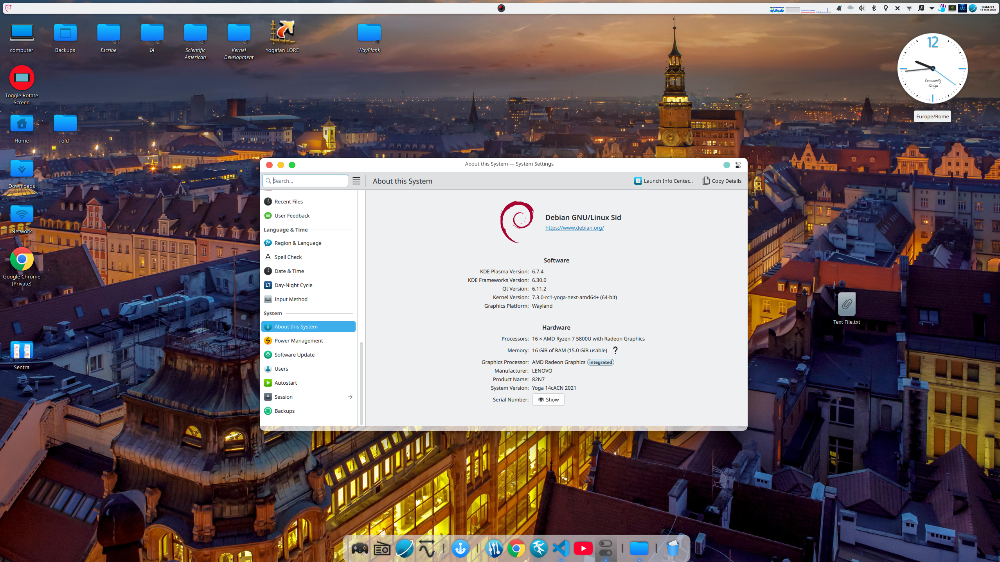
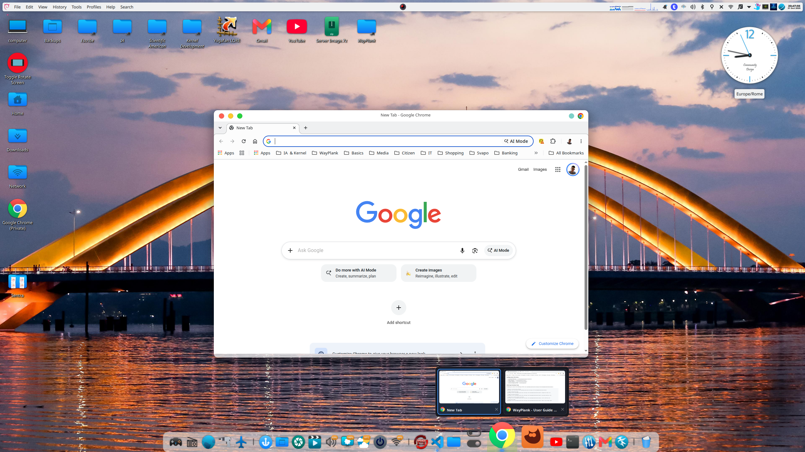

# WAYPLANK: THE ROAD TO WAYLAND DOCK

> A lightweight native Wayland dock, forked and modernized from Plank.
>
> Maintained by Sergio Melas (sergiomelas@gmail.com) © 2026
>
> [](LICENSE)
> [-brightgreen.svg)](Changelogs/CHANGELOG_v0.6.2.md)
> [-orange.svg)](README.md)
> [-success.svg)](FAT/2026-10-21%20FAT%200.6.2.3.txt)


---

> [!IMPORTANT]
> ### 📅 Release Schedule & Roadmap to Public Beta (v0.7.0)
> - **Currently on GitHub**: **v0.6.2.3 (Round 3)** is now officially live on GitHub!
> - **Week 45 (Monday, November 2, 2026)**: The milestone **WayPlank Public Beta (v0.7.0)** will officially launch on GitHub, allowing downstream collaborators and community testers full runway throughout Week 44.

> [!TIP]
> ### 🌍 Call for Translators — Help Localize WayPlank for Public Beta (v0.7.0)!
> In preparation for the Public Beta, all translations are maintained in a clean, self-contained Python generator script: [`po/generate_translations.py`](po/generate_translations.py).
> Complete string coverage already exists for **Simplified Chinese (`zh_CN`)**, **Italian (`it`)**, **Spanish (`es`)**, **French (`fr`)**, and **Catalan (`ca`)**.
>
> **Want to add your language (e.g. German, Portuguese, Polish, Japanese, etc.) or refine existing translations?**
> 1. Open [`po/generate_translations.py`](po/generate_translations.py), where all 312 strings are stored in a simple, structured Python dictionary.
> 2. Add or update your language entries directly in the dictionary (much cleaner and easier to manage than raw `.po` files!).
> 3. Submit your updated `generate_translations.py` by opening a [GitHub Issue](https://github.com/sergiomelas/WayPlank/issues)!
>
> ⏰ **Submission Window**: All languages received via GitHub Issues before the end of next week (**Sunday, November 1, 2026 — Week 44**) will be officially integrated into the Public Beta (v0.7.0) release!

---

## 📢 Current Status

Plank was completely unmaintained and broken on Wayland. Wayplank brings it back to life with a native Wayland architecture using `gtk-layer-shell`, modular bridges for different compositors, while preserving the fast and clean Cairo rendering engine we all loved.

I get why it might look like slop at first glance, but this is done with professional rigor. Before dumping code, every single change and architecture shift goes through strict Factory Acceptance Testing—you can literally check the logs in the FAT/ folder to see how every version is systematically tested and verified.

AI is fantastic for rapid prototyping and bringing boilerplate up fast, but this isn't just 'vibe coding'; it's heavily human-reviewed, debugged, and architected for real stability across KWin, Labwc, and Mutter. It’s a robust, hobbyist-driven, native Wayland solution. All compositor features, window previews, and theming integrations are verified with total engineering transparency. Take it or leave it, enjoy the code!

Starting from v0.4.3, Wayplank includes a native Hardware Abstraction Layer (HAL) working out of the box with **KWin (KDE Plasma)**, **Labwc (wlroots)**, and **GNOME Shell (Mutter)**. It auto-detects your compositor at startup without messy configs. 

## 🤝 Acknowledgments & Contributors


**A huge thank you to our 400+ community users: with 1,600+ lifetime downloads & clones and real-world feedback, 90+ bugs have been squashed across 335 validation points (100% FAT pass rate)! Testing, bug reports, and pull requests are warmly welcome.**

* **史有虎 (IFtiger-hu)** ([@IFtiger-hu-hub](https://github.com/IFtiger-hu-hub)): Author of the WayPlank community fork, contributor of native openSUSE/Fedora/RHEL RPM packaging (`BuildRpm.sh`), dock overflow smooth scrolling architecture, and launcher deduplication engine.


## 📖 Documentation

* 📚 [User Guide & Reference Manual](Documentation/USER_GUIDE.md)
* 🗺️ [v0.6.2 Fork Integration Roadmap](Documentation/WAYPLANK_V062_FORK_INTEGRATION_ROADMAP.md)
* 📖 [Technical migration report](Documentation/wayplank_x11_to_wayland_report_en.md)
* 🧪 [Compositor test matrix & protocols](FAT/)
* 📦 [Full technical changelogs](Changelogs/)

### 🎯 Compositor Support & Native HAL Architecture

WayPlank features a modular Hardware Abstraction Layer (HAL) with zero-configuration runtime auto-detection:

| Compositor / Desktop | Integration Engine | Key Capabilities | Status |
| :--- | :--- | :--- | :---: |
| **KDE Plasma 6 (KWin)** | D-Bus ECMAScript Bridge | Live Cairo window preview cards (`ScreenShot2` D-Bus IPC), `Bus.watch_name` bridge self-healing, bidirectional event tracking, atomic DRM `kscreen-doctor` brightness sync, real-time dark/light theme switching, 100% FAT pass | **Tier 1 (100% PASS)** |
| **GNOME Shell (Mutter)** | Monolithic Mutter Extension | Live Cairo window preview cards (`/mutter/screen/preview` IPC), 0.74s instant cold start, deterministic map activation (zero async timer crashes), native CSD HeaderBar dialogs, window Dodge/Intellihide, real-time dark/light theme switching, 100% FAT pass | **Tier 1 (100% PASS)** |
| **Labwc / wlroots** | `gtk-layer-shell` + `zwlr_foreign_toplevel` | Native C protocol bridge, Cairo blank preview cards with app icons & titles, Honest UI matrix, real-time dark/light theme switching, tested on LXQt 2.x & XFCE 4.20 Wayland | **Tier 1 (100% PASS)** |
| **Sway & Hyprland** | wlroots protocol extensions | Native layer-shell docking & workspace tracking | *In Roadmap* |

*For in-depth architectural details, protocol diagrams, and security model analysis, see [User Guide Chapter 8: Hardware Abstraction Layer (HAL)](Documentation/USER_GUIDE.md#8-hardware-abstraction-layer-hal--compositor-architecture).*

Feel free to star the repo or follow releases if you want to track progress!

---

> 🌟 **Zero Open Defects:** Across all 3 Tier-1 Wayland compositors (KDE Plasma 6, GNOME Shell, and Labwc), WayPlank v0.6.2.3 achieves 100% FAT compliance (335 passed, 0 open defects, 2 NA). Every validation point is documented with total engineering transparency in [`FAT/`](FAT/).

---

## 📸 Screenshots


<details>
<summary><b>🔍 Click to view full desktop integration (1920x1080), detail 1</b></summary>

<br>



</details>

<details>
<summary><b>🔍 Click to view full desktop integration (1920x1080), detail 2</b></summary>

<br>



</details>

---

# Universal Build & Installation Guide (Any Linux Distribution)

## 1. CORE DEPENDENCIES

To compile Wayplank from source and enable all docklets, ensure your distribution provides the required development libraries and runtime tools:

### Build Dependencies (Compiler & Headers):
- Vala compiler (`valac >= 0.40`)
- GTK+ 3.0 development headers (`gtk3` / `libgtk-3-dev`)
- GTK Layer Shell (`gtk-layer-shell` / `libgtk-layer-shell-dev`)
- Wayland Client library (`wayland` / `libwayland-client0` / `libwayland-dev`)
- JSON-GLib 1.0 (`json-glib` / `libjson-glib-dev`)
- LibGee 0.8 (`libgee` / `libgee-0.8-dev`)
- GLib 2.0 (`glib2` / `libglib2.0-dev`, includes `glib-compile-resources`)
- `pkg-config` / `base-devel` / `build-essential`

### Runtime Dependencies & Docklet Tools:
- **Screenshot Docklet (Labwc / wlroots / XFCE on Labwc):** `grim`, `slurp`
- **Screenshot Docklet (KDE Plasma):** `kde-spectacle`
- **Screenshot Docklet (XFCE / Generic X11):** `xfce4-screenshooter` or `flameshot`
- **Screen Brightness Docklet (Hardware control fallback):** `brightnessctl` (optional)

**Quick Install Commands:**
- **Debian / Ubuntu:**
  ```bash
  sudo apt install build-essential valac libgtk-3-dev libgtk-layer-shell-dev libwayland-dev libjson-glib-dev libgee-0.8-dev libglib2.0-dev grim slurp
  ```
- **Arch Linux:**
  ```bash
  sudo pacman -S --needed base-devel vala gtk3 gtk-layer-shell wayland json-glib libgee glib2 grim slurp
  ```
- **Fedora / RHEL:**
  ```bash
  sudo dnf install gcc vala gtk3-devel gtk-layer-shell-devel wayland-devel json-glib-devel libgee-devel glib2-devel grim slurp rpm-build
  ```
- **openSUSE (Tumbleweed / Leap):**
  ```bash
  sudo zypper install gcc vala gtk3-devel gtk-layer-shell-devel wayland-devel json-glib-devel libgee-devel glib2-devel grim slurp rpm-build
  ```

---

## 2. COMPILATION

### Option A: Universal Automated Build Script (Recommended for Any Distro)

Wayplank includes an automated standalone build script that compiles all Vala sources, C bridges, and GLib resources directly without distribution-specific dependencies:

```bash
chmod +x BuildBin.sh
./BuildBin.sh
```

The resulting standalone binary is generated in `build/wayplank`.

---

### Option B: Manual Step-by-Step Compilation

If you prefer building manually in your terminal:

```bash
# Step 1: Compile embedded GLib resources
glib-compile-resources --sourcedir=data --target=lib/resources.c --generate-source data/plank.gresource.xml

# Step 2: Compile native Wayplank binary (Vala + C bridges)
valac -g \
    --gresources=data/plank.gresource.xml \
    --gresourcesdir=data \
    --vapidir=vapi \
    --pkg posix --pkg gio-unix-2.0 --pkg gtk+-3.0 --pkg gtk-layer-shell-0 \
    --pkg json-glib-1.0 --pkg gee-0.8 --pkg compat --pkg config --pkg wlr-bridge \
    -X -D_GNU_SOURCE -X "-Dsetproctitle(x)=" \
    -X -DGETTEXT_PACKAGE=\"wayplank\" \
    -X -Ilib -X -Ilib/Protocols -X -Ilib/Services -X -Iinclude -X -w -X -lm -X -lwayland-client \
    $(find lib src -name "*.vala") \
    lib/resources.c \
    lib/gtk-compat.c \
    lib/Protocols/wlr-foreign-toplevel-management-protocol.c \
    lib/Services/wlr-toplevel-bridge.c \
    -o wayplank
```

---

### Step 3: Install Binary and Desktop Assets

Once built (via Option A or Option B), install the binary, themes, icons, and GSettings schemas:

```bash
# Install binary into /usr/local/bin
[ -f build/wayplank ] && sudo install -Dm755 build/wayplank /usr/local/bin/wayplank || sudo install -Dm755 wayplank /usr/local/bin/wayplank
sudo ln -sf /usr/local/bin/wayplank /usr/local/bin/plank

# Install themes and icons
sudo mkdir -p /usr/local/share/wayplank/themes
sudo cp -r data/themes/* /usr/local/share/wayplank/themes/
sudo cp -r data/icons/* /usr/local/share/icons/hicolor/

# Install and compile GSettings schemas
sudo cp data/glib-2.0/schemas/* /usr/local/share/glib-2.0/schemas/
sudo glib-compile-schemas /usr/local/share/glib-2.0/schemas/
```

---

## 3. AUTOMATED DEBIAN/UBUNTU PACKAGE CREATION

If running Debian, Ubuntu, or derivative distributions, run the automated packager to create a native `.deb`:

```bash
chmod +x BuildDeb.sh
./BuildDeb.sh
# Install with automatic dependency resolution:
sudo apt install ./build/wayplank_0.6.2.3_amd64.deb
# Or via dpkg:
# sudo dpkg -i build/wayplank_0.6.2.3_amd64.deb && sudo apt install -f
```

---

## 4. AUTOMATED OPENSUSE / FEDORA / RHEL RPM PACKAGE CREATION

If running openSUSE (Tumbleweed / Leap), Fedora, or RHEL-based distributions, run the automated RPM packager:

```bash
chmod +x BuildRpm.sh
./BuildRpm.sh

# Install on openSUSE with zypper:
sudo zypper install ./build/wayplank-0.6.2.3-1.x86_64.rpm

# Or install on Fedora/RHEL with dnf:
sudo dnf install ./build/wayplank-0.6.2.3-1.x86_64.rpm

# Or install via rpm directly:
sudo rpm -Uvh ./build/wayplank-0.6.2.3-1.x86_64.rpm
```

> 💡 **Headless / CI Environments:** You can bypass interactive prompts across all build scripts using `WAYPLANK_NO_PROMPT=1` (e.g. `WAYPLANK_NO_PROMPT=1 ./BuildRpm.sh`).

---

# RUNTIME DIRECTORIES & CONFIGURATION MIGRATION

Wayplank operates under its own isolated namespace and standard XDG locations:

- Configuration Directory: `~/.config/wayplank/`
- Application Launchers: `~/.config/wayplank/dock1/launchers/`
- Local User Themes: `~/.local/share/wayplank/themes/`
- System Themes: `/usr/share/wayplank/themes/` (or `/usr/local/share/wayplank/themes/`)

**Theme Configuration:**
Wayplank inspects both system and user theme paths natively. To change dock appearance:

```bash
wayplank --preferences
```

**Debug & Verbose Logging:**
To inspect running window hooks and debug output:

```bash
wayplank -d
```

---

# PROJECT ROADMAP & THE WAYLAND MILESTONES

- [x] Phase 1 (Completed) v0.1.0: Decoupled Standalone Fork
  - [x] Complete breakaway from unmaintained upstream Plank.
  - [x] Full namespace migration to 'wayplank' (configs, directories, launchers).
  - [x] Modern monolithic build system replacing broken autotools/autogen scripts.
  - [x] Multi-distro compatibility and standalone Debian packaging pipeline.

- [x] Phase 2 (Completed) v0.2.0: Application Discovery and Dock Lifecycle
  - [x] Implemented generic application discovery from running processes and desktop files.
  - [x] Added persistent pinned application handling and temporary running application icons.
  - [x] Implemented running-instance marking and multi-instance application management.

- [x] Phase 3 (Completed) v0.3.0: Declaration of Independence from X11 & Native Wayland Integration
  - [x] Implementation of Wayland native protocols.
  - [x] Complete phasing out of X11/XWayland dependencies. Support one compositor.
    This will be Kwin because it is the one I know the best.
  - [x] Full fractional scaling and native Wayland compositor window tracking.

- [x] Phase 4 (Completed) v0.4.0, v0.4.1, v0.4.2: KWin Stabilization, Monolithic Docklets & Bug Fixes
  - [x] Hardened KWin scripting bridge, overlap detection, and multi-monitor tracking.
  - [x] Implemented 8 embedded monolithic docklets (Trash, Clocks, Battery, CPU/RAM, Show Desktop, MPRIS, Volume).
  - [x] Bi-directional KWin & Plasma D-Bus trash bridge synchronization.
  - [x] Resolved icon bounce regressions, portal file launching, and process replacement (`--replace` / `-r`).

- [x] Phase 5 (Completed) v0.4.3: Multi-Compositor HAL & Support for Other Compositors (Labwc, wlroots, Mutter)
  - [x] Defined and implemented the modular Hardware Abstraction Layer (`WindowBackend` / `WindowControl`).
  - [x] Added native Labwc & wlroots support via `zwlr_foreign_toplevel_manager_v1` protocol and C bridge (v0.4.3).
  - [x] Zero-configuration runtime dynamic compositor auto-probing (Labwc vs KWin vs Mutter).
  - [x] Reactive Cairo indicator dots and cross-compositor Show Desktop toggle engine.
  - [x] State-based Dodge & Honest UI Matrix for Labwc (`DODGE_MAXIMIZED`, UI filtering, transparent fallback; validated on LXQt 2.x and XFCE 4.20).
  - [x] Native GNOME Shell / Mutter bridge integration (Phase 1): monolithic self-deploying GNOME Shell extension via D-Bus (`MutterBackend`), window state tracking, zero-notification banners, centered dialogs, and edge positioning (v0.4.3).
  - [x] Strict HAL coordinate isolation: native Layer Shell margins for KWin/Labwc and dedicated absolute screen positioning for Mutter (v0.4.3).
  - [x] Finalize GNOME Shell extension bridge for window geometry retrieval to support Intellihide & Dodge on Mutter.

- [x] Phase 6 (Completed) v0.5,..,v0.6.2.3: Fork Unification, Visual Cards & Pre-Beta Stabilization
  - [x] Multi-monitor selection persistence and edge placement fine-tuning across all compositors. 
  - [x] Complete 14 Monolithic Docklets Suite (v0.5.2): Trash, Analog Clock, Digital Clock, Battery, Screenshot, Preferences, Drive Ejector, CPU/RAM, Show Desktop, MPRIS, Volume, Session/Power, Screen Brightness, Weather Forecast.
  - [x] Categorize Items Architecture (v0.5.2): Semantic multi-zone layout (`[Folders] | [Docklets] | [Pinned Apps] | [Unpinned Transients] | [Trash]`), dynamic separator suppression, category drag clamping, and cross-separator drag pin/unpin.
  - [x] Cairo-Dock Style Folder Launcher Menu (v0.5.2): Left-click folder launcher menu (`FolderMenuWindow`) with 60 FPS icon zoom following, steady decoupled bounce, and tooltip styling.
  - [x] Community Fork Unification (v0.6.2.1): Automated openSUSE/Fedora RPM packaging (`BuildRpm.sh`), launcher deduplication, ghost bridge filtering, and dock overflow smooth scrolling with tachometer redline capacity indicator.
  - [x] Modern Ergonomics & Theming (v0.6.2.2): Remote web URL drag-and-drop, hover-to-raise window activation, FreeDesktop Settings portal sync, interactive Theme Manager with native portal file chooser, strict MIME validation, and clean drag-off poof removal.
  - [x] Multi-Window Preview Cards & Dynamic Theming (v0.6.2.3): Universal Cairo preview cards with live thumbnails on KWin and GNOME Mutter, clean blank card fallback on Labwc, real-time light/dark theme swapping across KDE and GNOME, recent files jump lists, and packaged stock themes.
  - [x] Folder Running Dots, Drawer Parity & Native Stacking (v0.6.2.3): Illuminated running indicator dots on pinned folder items (single dot for 1 active app, dual dots for 2+ active apps), running dots on drawer application rows with stabilized geometry, full drawer click/launch parity (Ctrl/Middle click for new instances, mouse wheel window cycling, context menu guard), elimination of Mutter async timer assertion crashes, KWin D-Bus auto-recovery, and clean bidirectional peer dialog stacking.
  - [x] Full multi-compositor FAT qualification: 335 tests executed, 333 passed (324 baseline + 9 squashed), 0 open defects, 2 NA (100% PASS rate).
  - [x] Finish documentation, packaging, and configuration migration.
  - [x] Official GitHub Release of v0.6.2.3 (Round 3).

- [ ] Phase 7 (Upcoming) WayPlank Public Beta (v0.7.0) & Road to Stable Release
  - [ ] **Week 45 (Monday, November 2, 2026): Official Launch of Public Beta (v0.7.0) on GitHub!**
  - [ ] Downstream collaborator synchronization & community testing buffer throughout Week 44.
  - [ ] Broaden community testing across additional wlroots compositors (Sway, Hyprland, Wayfire).
  - [ ] Publish Version 1.0 first stable with a clear list of supported compositors.
  - [ ] After release, focus on community bug fixes and compatibility updates.
---

# 📝 Release Highlights & Changelog

Here is a recap of the journey so far! For complete technical breakdown and FAT test matrix, see [`Changelogs/`](Changelogs/) and [`FAT/`](FAT/). 🚀

* 🚀 **v0.6.2.3 (Round 3, Pre-Beta) — Current Live GitHub Release (2026-10-22) [100% FAT PASSED]**:  
  Universal Cairo multi-window preview cards across all Wayland compositors (live D-Bus thumbnails on KWin and GNOME Mutter, clean blank card fallback on Labwc), dynamic real-time light/dark theme switching across KDE and GNOME, recent files jump list in context menus (`RecentFilesService`), packaged stock theme suite (Dark, Light, Arian Dark/Light, IFtiger Dark/Light), folder running indicator dots (single/dual on dock, row indicators in drawer), complete folder drawer application contract parity (middle/ctrl-click new instance, mouse wheel window cycling, row context menu guard), elimination of Mutter async timer crashes via deterministic map activation, KWin D-Bus bridge self-healing, native peer dialog stacking, and 0 open defects across 335 FAT test points. Directly paves the way for the **Public Beta (v0.7.0)** launching in Week 45 (Monday, November 2, 2026)!
* 🌟 **v0.6.2.2 (Round 2, Pre-Beta) — Current Live GitHub Release (2026-10-21) [COMPLETED / 100% FAT PASSED]**:  
  Remote web URL & browser shortcut DND delivery (`DesktopAppInfo.launch_uris`), hover-to-raise target window activation,  
  real-time dark/light portal color-scheme synchronization (`org.freedesktop.portal.Settings`), interactive Theme Manager  
  with native portal file chooser and archive installer (.zip/.tar.gz), strict FreeDesktop MIME type drop validation,  
  canonical launcher deduplication (`Posix.realpath` & `File.equal`), and clean KISS drag-off removal with instant poof animation.
* 🌟 **v0.6.2.1 (Round 1, Pre-Beta) — 2026-10-19 [COMPLETED / 100% FAT PASSED]**:  
  Native openSUSE/Fedora/RHEL RPM packaging (`BuildRpm.sh`), launcher deduplication & item reuse, ghost bridge window shield,  
  dock overflow smooth scrolling with tachometer redline capacity indicator, and multi-monitor DDC/CI sync with SP/PV decoupling.
* 💡 **v0.6.1 (Alpha) — 2026-10-15:** The Bug Hunting Release — Multi-monitor KWin brightness sync, unified Global System Pressure engine, drag-and-drop payload delivery & 0-byte MIME fix, docklet icon standardization & adaptive dynamic Gtk+ theme engine.
* ✨ **v0.6.0 (Alpha) — 2026-10-11:** Smart first-run auto-configuration (categorized English app drawers, auto-detected pinned apps, docklets & trash), universal "Change Icon..." dialog with FreeDesktop & GIO metadata, integrated User Guide, and clean release polish.
* 🚀 **v0.5.2 (Alpha) — 2026-10-09:** Cairo folder launcher menu, 14 built-in docklets, category layout grouping and deep audit fixing stack overflows & GObject assertions.
* 🛠️ **v0.5.1 (Alpha) — 2026-10-08:** Fixed KWin resume freeze on Plasma 6 with 50ms debouncer, native screenshot docklet and 100% FAT pass rate.
* 🖥️ **v0.5.0 (Alpha) — 2026-10-07:** Solved multi-monitor duplicate ID collisions, live monitor hotplugging and Mutter drag race fixes.
* 🧩 **v0.4.3 (Pre-Alpha) — 2026-10-05:** Modular Multi-Compositor HAL: dynamic auto-probing for KWin, Labwc (via `zwlr_foreign_toplevel`) and GNOME Shell bridge.
* 📦 **v0.4.2 (Pre-Alpha) — 2026-10-02:** First 8 monolithic docklets (Trash, Clock, Battery, etc.), total purge of X11 libs and `--replace` flag.
* ⚙️ **v0.4.1 (Pre-Alpha) — 2026-09-25:** Multi-monitor config persistence, secondary display tooltip fix and smooth zoom without micro-stutters.
* 🪟 **v0.4.0 (Pre-Alpha) — 2026-09-24:** KWin D-Bus scripting bridge, real-time window Dodge/Intellihide and layer-shell input region negotiation.
* 📌 **v0.3.0 (Pre-Alpha) — 2026-09-23:** Drag-and-drop icon pinning, running app dots and native compositor-safe window tracking.
* 🏗️ **v0.2.0 (Pre-Alpha) — 2026-09-22:** Native `gtk-layer-shell` integration, `/proc` process scanner and standalone packaging scripts.
* 🌱 **v0.1.0 (Pre-Alpha) — 2026-09-19:** Initial standalone fork from Plank, clean namespace migration to `wayplank` and XDG isolated paths.

👉 *Read the full detailed commits and milestone notes in [`Changelogs/`](Changelogs/).*
 

---

## ⚖️ License & Integrated Assets Attribution

Wayplank is free software licensed under the **GNU General Public License v3.0 or later** ([GPL-3.0-or-later](LICENSE)).

### 1. Core Project & Codebase
* **License**: GNU General Public License v3.0 or later ([GPL-3.0-or-later](LICENSE)).
* **Original Plank Codebase**: © 2011–2015 Robert Dyer, Michal Hruby, Rico Tzschichholz, and Plank contributors.
* **Wayplank Fork & Architecture**: © 2026 Sergio Melas (<sergiomelas@gmail.com>).

### 2. Integrated Fallback Assets & Vector Artwork
Wayplank incorporates high-definition vector assets compiled directly into the binary executable via GLib GResources (`/net/launchpad/plank/docklets/`) to provide self-contained, standalone operation on any desktop or minimal distribution:
* **Docklet Fallback Icons** (`data/docklets/`):
  * **Volume Scale**: Overamplified (>100%), High, Medium, Low, Muted (`volume-*.svg`).
  * **Battery Scale**: Full, Good, Low, Caution, Empty, Full-Charging, Good-Charging, Low-Charging, Caution-Charging, Empty-Charging, AC-Adapter, Missing (`battery-*.svg`).
  * **Brightness Scale**: High, Medium, Low, Base (`brightness-*.svg`).
  * **Weather Forecast Scale**: Clear, Few Clouds, Overcast, Showers, Snow, Storm, Fog (`weather-*.svg`).
  * **Clock & Time**: Analog Clock (`clock.svg`), Digital LED Clock (`digital-clock.svg`).
  * **System & Hardware**: Trash empty/full (`trash.svg`, `trash-full.svg`), Global System Pressure Monitor (`cpu.svg`), Show Desktop (`desktop.svg`), MPRIS Media Player (`mpris.svg`), Screenshot (`screenshot.svg`), Session/Power (`session.svg`), Wayplank Preferences (`preferences.svg`), Removable Drive Ejector (`ejector.svg`).
* **Attribution & Upstream**: Derived from FreeDesktop & KDE Breeze icon specifications © KDE Community / Breeze Icon Artists, licensed under **LGPL-3.0-or-later** / **GPL-3.0-or-later**.
* **Zero Host Pollution**: All fallback icons are strictly compiled into the internal executable binary; no extra icon files are installed into `/usr/share/icons/hicolor/`, ensuring pure standalone behavior and complete distribution independence.


